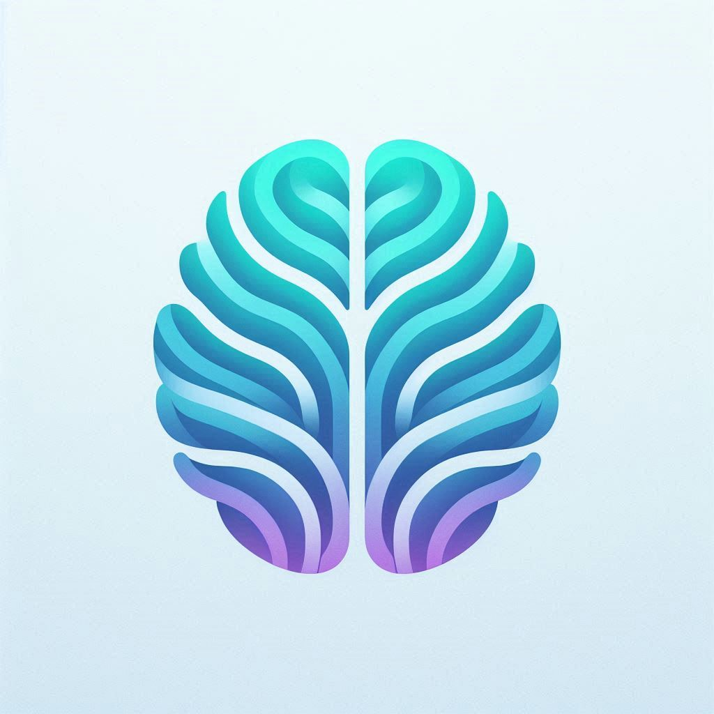

<div align="center">
  
  <h1>NeuroBreak</h1>
  <h3>Plataforma de Optimización Cognitiva Basada en Datos</h3>
  <p>
    <i>Bienestar de alto rendimiento para el atleta digital.</i>
  </p>
</div>

---

## 🧠 ¿Qué es NeuroBreak?

**NeuroBreak** es una plataforma especializada diseñada para trabajadores del conocimiento, desarrolladores y profesionales digitales que pasan largas horas frente a un escritorio. Actúa como un **"Monitor del Sistema" para tu cuerpo y cerebro**, ayudándote a mantener un rendimiento cognitivo máximo mientras previenes el agotamiento físico.

A diferencia de las aplicaciones de fitness genéricas, NeuroBreak se centra en la **micro-dosificación del bienestar**: intervenciones cortas y de alto impacto que se integran perfectamente en un horario de trabajo profundo ("deep work").

## 🚀 Características Principales

### 1. 📊 Tablero de Vitalidad Cerebral

- **Monitoreo en Tiempo Real**: Rastrea tu **Claridad Mental** y **Salud de Espalda** basado en tu historial de sesiones.
- **Carga Neuronal**: Visualiza tu fatiga cognitiva y sugiere cuándo tomar un descanso.
- **Progreso Gamificado**: Gana puntos de "Sinergia" al completar rituales diarios.

### 2. ⚡ Motor de Movimiento

- **Rituales Curados**: Accede a una biblioteca de "bio-hacks" científicos (ej. _Reinicio de Dopamina_, _Descompresión Espinal_, _Refresco Ocular_).
- **Sesiones Guiadas**: Temporizadores interactivos y guías visuales para ejercicios diseñados específicamente para trabajadores de escritorio.
- **Alivio Instantáneo**: Soluciona el dolor de espalda, la fatiga visual y la "niebla mental" en menos de 5 minutos.

### 3. 🧪 Laboratorio Cognitivo (Insights IA)

- **Pronóstico Neuronal**: Utiliza **IA** para analizar tus datos de fatiga y predecir tu ventana de trabajo óptima.
- **Sinergia Nutricional**: Genera consejos nutricionales diarios respaldados por la ciencia (ej. combinar _Vitamina D + Omega-3_) para impulsar la neuroplasticidad.
- **Análisis Inteligente**: Impulsado por **Llama 3 (vía Groq)** para una inteligencia de salud rápida y precisa.

### 4. 🤖 Neuro-Asistente (NUEVO)

- **Chatbot con IA**: Un asistente integrado disponible 24/7.
- **Pregunta lo que sea**: Consulta a la IA sobre postura, dieta, optimización del sueño o trucos de productividad.
- **Consciente del Contexto**: Entiende tu estado actual para dar consejos relevantes.

### 5. 📱 Responsivo (Móvil)

- **Multiplataforma**: Totalmente funcional en Escritorio y Móvil.
- **Sobre la marcha**: Lleva tus rituales de bienestar contigo a cualquier lugar.

---

## 🛠️ Stack Tecnológico

- **Frontend**: React (Vite), TypeScript
- **Estilos**: Tailwind CSS
- **Backend / Auth**: Supabase
- **IA / LLM**: Groq API (Llama 3-70b)
- **Iconos**: Material Symbols

---

## 💻 Ejecutar Localmente

1.  **Clonar el repositorio**

    ```bash
    git clone https://github.com/tu-usuario/neurobreak.git
    cd neurobreak
    ```

2.  **Instalar dependencias**

    ```bash
    npm install
    ```

3.  **Configuración de Entorno**
    Crea un archivo `.env.local` en el directorio raíz y añade tus claves:

    ```env
    VITE_SUPABASE_URL=tu_url_supabase
    VITE_SUPABASE_ANON_KEY=tu_clave_supabase
    VITE_GROQ_API_KEY=tu_api_key_groq
    ```

4.  **Ejecutar la App**
    ```bash
    npm run dev
    ```

---

## 🤝 Contribuir

¡Agradecemos las contribuciones para ayudar a optimizar los cerebros de los trabajadores en todas partes! Por favor, haz un fork del repo y envía un PR.

---

_NeuroBreak © 2026 - optimiza tu hardware._
